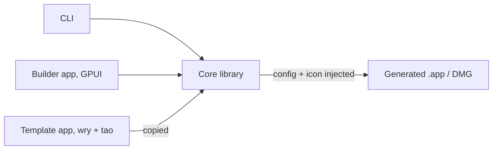

# PRD: Rake

Rake is a Pake alternative that turns any website into a small native desktop app in seconds, using a CLI or a GPUI desktop app, with no Rust toolchain on the user's machine.

## Problem

Pake wraps websites as desktop apps, but it compiles a Rust and Tauri project for every app. First-time setup takes 5 to 10 minutes and needs Rust installed. The apps themselves are already small (3.6 to 5.6 MB on Windows and Linux `.deb`, 8.8 to 14.2 MB as a macOS DMG), because Pake uses the system webview through wry.

**Key insight:** the slow, heavy part is the per-app build, not the runtime. A prebuilt template app with config injected at build time removes the compile entirely.

## Goals

- Build an app from a URL in under 10 seconds.
- No Rust, Node or Xcode needed on the user's machine.
- Generated apps no bigger than Pake's.
- CLI and desktop builder app share one core library.
- Download the template app on first run and cache it.

## Non-goals

- Bundling a browser engine (Chromium or CEF).
- Embedding a webview inside GPUI.
- App store distribution in the MVP.
- Full Pake option parity in the MVP.
- Strict compatibility with Pake's config format.
- Live preview in the first builder app release.

## Users and use cases

- A developer who wants web tools (mail, chat, dashboards) as separate dock apps with their own windows and shortcuts.
- A user who prefers a GUI: paste a URL, pick an icon, press Build.
- Scripts and CI that generate apps from a config file and read the `--json` result.

## Architecture

- **Template app:** wry + tao. Reads `config.json` from `Contents/Resources` at launch. Uses the system webview: WKWebView, WebView2, WebKitGTK.
- **Core library:** copies the template, writes config and inject files, converts icons, patches `Info.plist`, signs, packages.
- **CLI:** thin wrapper over the core library. Pake-style flags, its own `--config` schema, `--json`. Downloads the template for the current OS and architecture on first run and caches it.
- **Builder app:** GPUI form over the core library. Live preview comes later, in a separate wry window, not inside GPUI.

GPUI stays out of generated apps on purpose. Its webview crate is experimental, does not support native Wayland, and draws over GPUI menus on Windows, and it would add size without changing the web engine.

## Functional requirements

### MVP options (P0)

| Option | Behaviour |
|---|---|
| `url` | Web URL to wrap. Required unless `--config` supplies it. |
| `--name` | App name, used for the bundle and menu. |
| `--identifier` | Bundle ID. Default derived from URL and name. |
| `--icon` | Local or remote image. Default: fetch the site favicon. |
| `--width` / `--height` | Initial window size. Default 1200 × 780. |
| `--min-width` / `--min-height` | Smallest window size. |
| `--title` | Window title. |
| `--user-agent` | Custom user agent. |
| `--hide-title-bar` | Immersive header on macOS. |
| `--dark-mode` | Force dark appearance. |
| `--inject` | Extra CSS or JS files loaded into the page. |
| `--safe-domain` | Domains that stay in-app. Others open in the default browser. |
| `--debug` | Enable devtools and verbose logs. |
| `--config` | Read options from Rake's own JSON schema. Flags override the file. Pake configs are not required to work. |
| `--json` | One JSON result on stdout, with exit codes 0 to 4 like Pake. |
| `--install` | Copy the app into `/Applications`. |

### Later (P1 and P2)

- Window: fullscreen, maximize, always-on-top, zoom, hide-on-close, multi-window, multi-instance.
- Navigation: internal-url-regex, new-window popups, find in page, downloads, drag and drop, incognito.
- System: tray icon, start to tray, global activation shortcut, camera and microphone entitlements.
- Network: proxy, basic auth, WASM COOP/COEP headers.
- Distribution: Developer ID signing, notarization, Windows and Linux installers.

### Builder app

- Form covering every P0 option, with the same defaults as the CLI.
- Icon picker with favicon fetch and a preview.
- Build button with progress, then reveal the app in Finder.
- Import and export the config JSON, so a GUI setup can be reused in the CLI.
- Later: preview button that opens the URL in a temporary wry window with the chosen settings.

## Non-functional requirements

| Requirement | Target |
|---|---|
| Build time, cached template | Under 10 seconds |
| First build | Template download plus build; download size to be measured in M1 |
| Generated app size | No larger than Pake's on the same platform |
| Toolchain on user machine | None |
| App cold start | To be measured against Pake in M1 |
| Idle memory | To be measured against Pake in M1 |

## Risks

- **Signing:** editing a signed `.app` breaks its signature, so the core must re-sign after every change. Other people's Macs will warn until notarization exists.
- **GPUI versioning:** the crates.io `gpui` release is 0.2.2 from Oct 2025; newer code comes from git or the community `gpui-pre` crate. Pin an exact version.
- **Linux Wayland:** wry child webviews need X11; native Wayland needs a GTK container. Affects the template app on Linux, planned for M5.
- **Windows icons:** the exe icon must be swapped in resources after build; tool choice not yet verified.
- **Licensing:** Pake is GPL-3.0 and Rake is MIT, so reuse Pake's ideas but never copy its code.
- **Template download:** first run needs network, and the CLI must verify the download (checksum) and pin the template to its own version.

## Decisions

| Topic | Decision |
|---|---|
| Name | Rake. The crates.io names `rake` and `rake-cli` are already taken, so publish crates under other names or install from GitHub Releases. |
| License | MIT |
| Template delivery | Downloaded on first run and cached, not bundled in the CLI |
| Pake config compatibility | Not a hard requirement |
| Builder live preview | After M4 |

See [ROADMAP.md](ROADMAP.md) for milestones and repo layout.

## Sources

- [Pake CLI usage](https://github.com/tw93/Pake/blob/main/docs/cli-usage.md)
- [Pake releases (app sizes)](https://github.com/tw93/Pake/releases)
- [gpui-webview crate](https://github.com/longbridge/gpui-component/tree/main/crates/webview)
- [wry](https://github.com/tauri-apps/wry)
- [gpui on crates.io](https://crates.io/crates/gpui)
